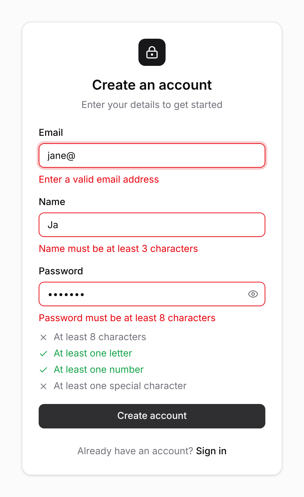
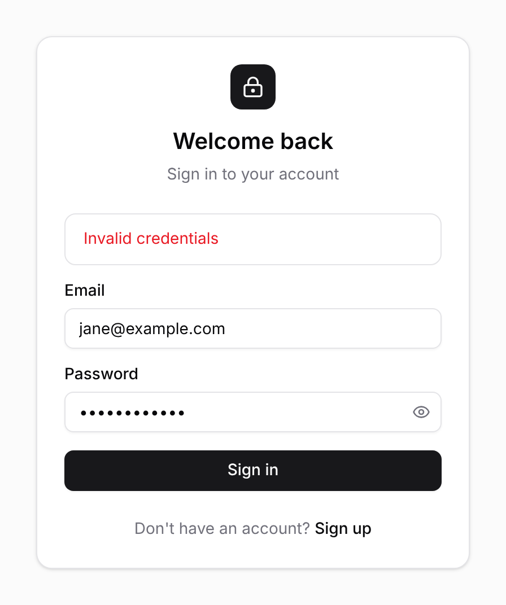
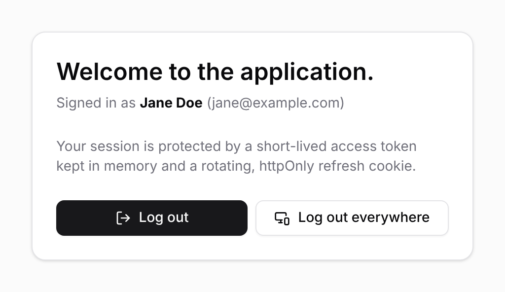
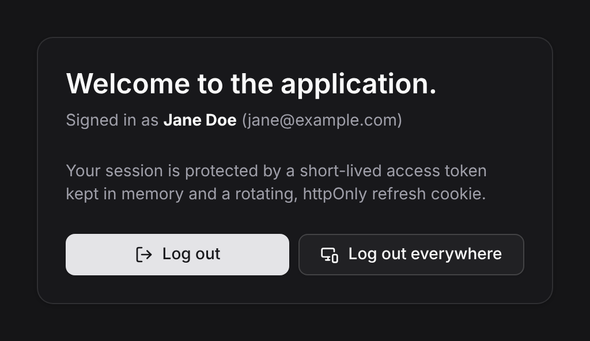
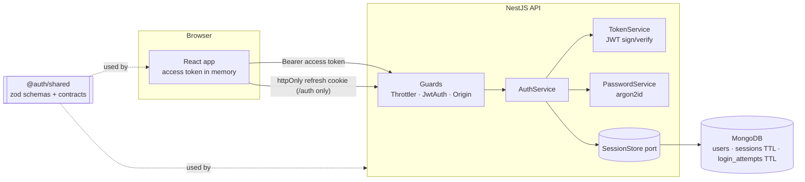
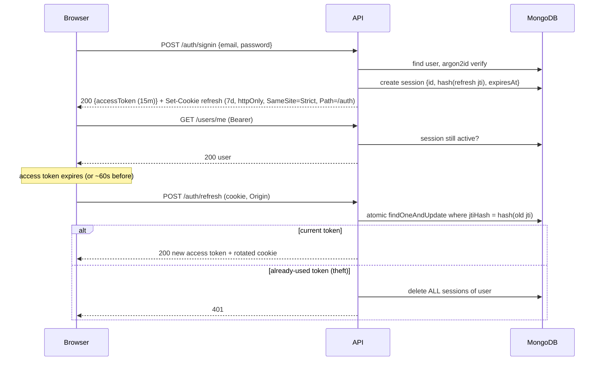

# Auth Task — NestJS + React sign up / sign in

A production-minded authentication module: **NestJS + MongoDB** API and a **React + TypeScript** web app
in a pnpm monorepo, with one shared validation package so client and server rules can never drift.

|             |                                                                                                         |
| ----------- | ------------------------------------------------------------------------------------------------------- |
| **API**     | NestJS 11, Mongoose 9, JWT (access + rotating refresh), argon2id, nestjs-pino, Swagger                  |
| **Web**     | React 19, Vite, shadcn/ui + Tailwind v4, TanStack Query, react-hook-form                                |
| **Shared**  | zod schemas + API contract types (`@auth/shared`)                                                       |
| **Quality** | strict TS (no `any`), type-aware ESLint, 126 API unit tests, integration + e2e suites, 36 web tests, CI |

## Screenshots

| Sign up — live validation                                                                                                               | Sign in — generic error                                                                                            |
| --------------------------------------------------------------------------------------------------------------------------------------- | ------------------------------------------------------------------------------------------------------------------ |
|  |  |

| Welcome page (protected)                                                                                        | Dark mode                                                                                 |
| --------------------------------------------------------------------------------------------------------------- | ----------------------------------------------------------------------------------------- |
|  |  |

---

## Quick start

Prerequisites: **Node 22+**, **pnpm 10** (`corepack enable`), **Docker** (for MongoDB).

```bash
pnpm install
docker compose up -d                      # MongoDB on localhost:27017

cp apps/api/.env.example apps/api/.env    # then fill in the two JWT secrets:
node -e "console.log(require('crypto').randomBytes(48).toString('base64url'))"

cp apps/web/.env.example apps/web/.env

pnpm dev                                  # API → http://localhost:3000   Web → http://localhost:5173
```

- Swagger UI: http://localhost:3000/docs (disabled when `NODE_ENV=production`)
- Health: http://localhost:3000/health

The API refuses to start with missing or weak configuration (e.g. secrets shorter than 32 characters
or identical access/refresh secrets) and prints exactly what is wrong.

## Scripts (from the repo root)

| Command          | What it does                                                                    |
| ---------------- | ------------------------------------------------------------------------------- |
| `pnpm dev`       | Builds `@auth/shared`, then runs API (watch) and web (Vite) together            |
| `pnpm build`     | Builds every package                                                            |
| `pnpm typecheck` | `tsc --noEmit` in every package                                                 |
| `pnpm lint`      | ESLint (type-aware, `--max-warnings 0`)                                         |
| `pnpm test`      | Unit tests: shared + API + web                                                  |
| `pnpm test:cov`  | Unit tests with coverage gates (CI fails below them)                            |
| `pnpm test:e2e`  | API integration + e2e against MongoDB (`MONGO_URI_TEST` or an in-memory server) |
| `pnpm format`    | Prettier                                                                        |

> e2e tests use `MONGO_URI_TEST` when set (e.g. `MONGO_URI_TEST=mongodb://127.0.0.1:27017` with
> docker compose running), otherwise they download and start `mongodb-memory-server`.

## Architecture



```
apps/api/src
├── main.ts · bootstrap.ts · app.module.ts
├── config/            zod env schema + typed, injectable AppConfig
├── database/          DatabaseModule (connection), Mongo hardening, Mongo error helpers
├── repositories/      RepositoriesModule — the persistence boundary
│   ├── interfaces/    UsersRepository, SessionsRepository, LoginAttemptsRepository + injection tokens
│   ├── models/        domain models returned by repositories (User, Session, RotationResult, …)
│   ├── schemas/       Mongoose schemas (user, session, login-attempt)
│   ├── mongo/         Mongo implementations of the interfaces
│   └── errors/        persistence-agnostic errors (DuplicateEmailError)
├── auth/              AuthModule
│   ├── auth.controller.ts · auth.service.ts · auth.module.ts
│   ├── services/      PasswordService (argon2id)
│   ├── guards/        JwtAuthGuard
│   ├── decorators/    @CurrentUser, @AuthRateLimited
│   ├── interfaces/    AuthUser, AuthResult
│   ├── constants/     messages, metadata keys
│   ├── config/        throttler configuration
│   └── utils/         refresh cookie, bearer token parsing
├── tokens/            TokensModule — JWT sign/verify; schemas/ (zod claims), interfaces/
├── users/             UsersModule — GET /users/me, UsersService, mappers/ (User → UserDto)
├── health/            /health (terminus + Mongo ping)
└── common/            cross-cutting
    ├── filters/ guards/ decorators/ pipes/ exceptions/ openapi/ utils/
    ├── interfaces/    ClientContext, ValidationDetails, NormalizedError, OpenApiSchema
    └── logging/       LoggingModule, pino config, AuditLogger, interfaces/

apps/api/test          utils/ (factories, typed mocks, testing-module builder), integration/, e2e/
apps/web/src           lib/api (client, token store, endpoints), features/auth, pages, components/ui
packages/shared        zod schemas, password rules, API contract types
docs/adr               architecture decision records
```

**Layering:** controllers → services → repository **interfaces** (injected by token) → Mongo implementations.
Services never import Mongoose; only `repositories/mongo` and `database/` do.

## API

| Method | Path               | Auth                      | Description                                                              |
| ------ | ------------------ | ------------------------- | ------------------------------------------------------------------------ |
| POST   | `/auth/signup`     | –                         | Create account → `201 { accessToken, expiresIn, user }` + refresh cookie |
| POST   | `/auth/signin`     | –                         | Sign in → `200 { accessToken, expiresIn, user }` + refresh cookie        |
| POST   | `/auth/refresh`    | refresh cookie + `Origin` | Rotate refresh token, issue new access token                             |
| POST   | `/auth/logout`     | refresh cookie + `Origin` | End current session (idempotent) → `204`                                 |
| POST   | `/auth/logout-all` | Bearer                    | End every session of the user → `204`                                    |
| GET    | `/auth/sessions`   | Bearer                    | List active sessions (device, IP, last used)                             |
| GET    | `/users/me`        | Bearer                    | **Protected endpoint** — current user                                    |
| GET    | `/health`          | –                         | Liveness + MongoDB ping                                                  |

Every error has the same shape (from `@auth/shared`):

```json
{
  "statusCode": 400,
  "error": "Bad Request",
  "message": "Validation failed",
  "details": { "password": ["Password must contain at least one number"] },
  "path": "/auth/signup",
  "timestamp": "…",
  "requestId": "…"
}
```

## Auth flow



## Type safety

- `strict` plus `noUncheckedIndexedAccess`, `exactOptionalPropertyTypes`, `noPropertyAccessFromIndexSignature`, `useUnknownInCatchVariables`, …
- ESLint `strictTypeChecked`: `no-explicit-any`, every `no-unsafe-*`, `consistent-type-assertions: never` (tests excepted), `explicit-module-boundary-types`, `no-floating-promises`, `switch-exhaustiveness-check`.
- **One schema, three uses:** the zod schemas in `@auth/shared` validate the web forms, validate API request bodies, and generate the Swagger docs. Types are inferred from them, never duplicated.
- Untrusted data is `unknown` until parsed: env vars, JWT payloads, cookies, API responses in the web client, `catch` variables.
- Exhaustive unions (`RotationResult`, `AuditEvent`) are handled with `switch` and checked by the linter.
- CI fails on any type error or lint warning.

## Security summary

Full threat model in [SECURITY.md](SECURITY.md). Highlights:

- argon2id (OWASP parameters); identical response **and timing** for unknown email vs wrong password
- Access token only in memory; refresh token in an httpOnly, `SameSite=Strict`, `Path=/auth` cookie (`__Secure-` prefixed in prod)
- Refresh **rotation with reuse detection** — a replayed token revokes every session of the user
- Server-side sessions (MongoDB TTL): logout / logout-all / theft response take effect immediately
- Per-IP throttling on credential routes + per-email lockout; NoSQL-injection defence in depth (strict zod + `sanitizeFilter`)
- helmet, strict CORS allow-list, `Origin` check on cookie endpoints, 10 kB JSON-only bodies, CSP on the web build
- Logs: request ids, redaction of credentials/tokens/cookies, audit events for security-relevant actions

## Testing

| Suite           | Tooling                                                | Covers                                                                                                              |
| --------------- | ------------------------------------------------------ | ------------------------------------------------------------------------------------------------------------------- |
| Shared          | Vitest                                                 | each password rule, normalisation, strictness, contracts                                                            |
| API unit (120)  | Jest + SWC, typed mocks                                | services, guards, filter, pipes, logging, config — gates 80% global / 90% auth+tokens                               |
| API integration | Jest + real MongoDB                                    | atomic rotation & concurrent refresh race, TTL handling, lockout window, unique email                               |
| API e2e         | supertest, real `AppModule` + production HTTP pipeline | full flow, reuse detection, logout semantics, enumeration, lockout, injection, CSRF, body limit, headers, CORS, 429 |
| Web (36)        | Vitest + RTL + MSW                                     | validation messages, checklist, error mapping, redirects, guards, refresh mutex, logout                             |

## Trade-offs

- **Sessions in MongoDB, not Redis** — no extra infrastructure for this scope; `SessionStore` is an interface, so Redis is a drop-in for scale ([ADR 0003](docs/adr/0003-sessions-in-mongodb-ttl.md)).
- **Throttler storage is in-memory** (per instance). The per-email lockout is persisted in MongoDB, so it survives restarts; a shared throttler store is listed below.
- **Sign-up reveals whether an email exists (409)** — the usual UX trade-off; mitigated by rate limiting. The fix is email verification (below).
- **Per-email lockout can be abused to lock someone out** — bounded window (15 min); see SECURITY.md.
- **Deploy web and API on the same site** (e.g. `app.example.com` + `api.example.com`): the refresh cookie is
  `SameSite=Strict`, which browsers don't send cross-site. Different sites would need `SameSite=None` plus a CSRF token.

## Next steps (with more time)

- Email verification and password reset (one-time, hashed, expiring tokens)
- Optional 2FA (TOTP / WebAuthn)
- RS256 with key rotation (JWKS) if other services need to verify tokens
- Redis-backed `SessionStore` and throttler storage for horizontal scaling
- OpenTelemetry tracing (request ids are already propagated)
- Turborepo for cached builds; Playwright smoke test of the real UI against the real API

## AI usage

See [AI.md](AI.md). The project's agent instructions are in [CLAUDE.md](CLAUDE.md).
